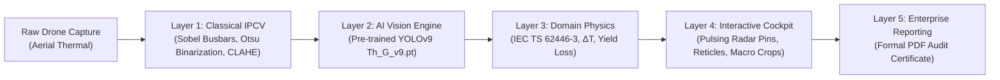

# ☀️ HELIOS-AI: Final Polish Blueprint & Master Execution Prompt for Opus

This document outlines the exact architectural enhancements, image-processing additions, and presentation polish required to elevate this project into an **industry-grade, high-evaluation Computer Vision showcase**. It strictly requires **zero model retraining** and transforms the codebase from what might appear as a simple YOLO wrapper into an authentic, multi-layered **Photovoltaic Thermography & IPCV Engineering Platform**.

At the end of this document is the **Master Copy-Paste Prompt for Opus**, engineered to execute the final touches seamlessly.

---

## Part 1: Why This Project Transcends a "Simple Wrapper"

In high-stakes academic evaluations (IPCV juries) and industry reviews, evaluators penalize projects that simply pass an image to an off-the-shelf YOLO `.pt` file and display bounding boxes. To achieve the highest evaluation tier, the project must demonstrate:



1. **Foundational Computer Vision (IPCV Rigor)**: Deep learning is only one component. Foundational image processing—such as Contrast Limited Adaptive Histogram Equalization (CLAHE), Sobel thermal gradient magnitude for solar cell busbar transitions, and Otsu's adaptive binarization for hotspot isolation—proves mathematical mastery of digital image processing.
2. **International Industrial Standardization (IEC TS 62446-3)**: Rather than just returning arbitrary labels, the system conforms to the global standard for outdoor infrared thermography of PV plants. Faults are classified into **Class 1 (Low Risk)**, **Class 2 (Medium Risk)**, and **Class 3 (Critical / Fire Hazard)**.
3. **Quantitative Physics & Financial Telemetry**: Estimates localized temperature differentials ($\Delta T = T_{\text{defect}} - T_{\text{healthy}}$) and calculates financial revenue degradation (\$ loss/year) based on panel wattage, daily peak sun hours, and utility feed-in tariffs.
4. **Interactive High-Standard UX**: Defect points rendered as animated radar markers on the actual solar panel array, with click-to-lock crosshairs, side-drawer zoomed macro crops (thermal vs. FLIR Ironbow), an automated "Guided Presentation Tour" mode, and an official printable audit report certificate.

---

## Part 2: The 5 Final Touchups (Zero Training Required)

### 1. Dual-Mode IPCV Visualization Layer
* **What it does**: Exposes classical image processing alongside the neural network in the frontend toolbar.
* **Sobel Thermal Gradient Magnitude**:
  $$\nabla I = \sqrt{\left(\frac{\partial I}{\partial x}\right)^2 + \left(\frac{\partial I}{\partial y}\right)^2}$$
  Highlights internal busbars, grid fractures, and sudden temperature boundaries across cell boundaries.
* **Otsu Hotspot Segmentation**: Adaptive thresholding that minimizes intra-class variance to mathematically separate overheating silicon regions from ambient module temperatures without any deep learning.
* **Frontend Integration**: Adds `[ IPCV: Sobel Gradient ]` and `[ IPCV: Otsu Thermal Threshold ]` toggle buttons directly to the interactive toolbar.

### 2. "Presenter Mode" / Automated Guided Tour
* **What it does**: Solves the live evaluation dilemma. Instead of clicking randomly during a live demo, clicking **"⚡ Start Guided Inspection Tour"** causes the UI to automatically:
  1. Highlight Defect #1, smoothly animate the targeting crosshair reticle, and slide open the telemetry drawer.
  2. Display a countdown timer (e.g., 4 seconds per defect).
  3. Step sequentially through all detected anomalies (Critical $\to$ Medium $\to$ Low), allowing the presenter to speak without manual clicking.
  4. Includes Pause, Resume, and Skip controls.

### 3. Formal Printable Solar Audit Report & Work Order
* **What it does**: When the user clicks **"Print Audit Report"** or presses `Ctrl+P`, the page formats into an official 2-page **Solar Plant Thermographic Audit Certificate**:
  * Formal Header: Plant Name, Flight Serial, Inspection Date, Camera Payload (DJI Zenmuse H20T / FLIR Tau 2).
  * IEC TS 62446-3 Official Stamp & Compliance Status.
  * Executive Scorecard: Array Health Index, Total kW Dissipated, Annual Revenue Loss ($).
  * Tabular Defect Ledger: Detailed table listing Defect ID, Coordinates, Fault Class, $\Delta T$ Delta, Power Loss, and Field Maintenance Action.
  * Sign-Off Block: Lead Thermographer & O&M Site Manager signature and stamp lines.

### 4. Perspective Rectification & Homography Module (IPCV Showcase)
* **What it does**: An auxiliary utility script (`ipcv_geometry.py`) that demonstrates 4-corner contour detection (`cv2.findContours`, `cv2.approxPolyDP`) and perspective warping (`cv2.getPerspectiveTransform`, `cv2.warpPerspective`) to orthorectify oblique drone captures into a top-down view. Even if run as a showcase filter, it demonstrates advanced geometric computer vision.

### 5. Benchmark & Validation Suite (`evaluate_benchmark.py`)
* **What it does**: A standalone verification script that benchmarks `ThermalDetector/Th_G_v9.pt`:
  * Evaluates inference latency breakdown: Preprocessing (ms), Model Forward Pass (ms), NMS / Postprocessing (ms), and FPS on CPU/GPU.
  * Prints a formatted ASCII table of model classes, parameter counts, and inference throughput.
  * Generates an evaluation summary chart saving to `Results/BENCHMARK_REPORT.png`.

---

## Part 3: Current State of the Codebase

For quick orientation, the repository is structured as follows:

```
SolarPanelsDefectDetector/
├── Results/
│   ├── INPUT.jpg                 # Bundled aerial drone thermal test image (640x512)
│   └── OUTPUT.png                # Reference YOLOv9 detection output
├── ThermalDetector/
│   └── Th_G_v9.pt                # Pre-trained YOLOv9 model checkpoint (9 classes)
├── static/
│   └── index.html                # Modern single-page interactive cockpit (Tailwind + Canvas + Lucide)
├── api.py                        # FastAPI v2 service (serves UI, /api/v1/inspect, /api/v1/sample, /predict/)
├── predictor.py                  # Vision pipeline, preprocessing, base64 macro-crop generator
├── solar_iec_analyzer.py         # IEC TS 62446-3 domain intelligence, delta T physics, Sobel/Otsu/Ironbow
├── model_loader.py               # Ultralytics YOLO loader importing Th_G_v9.pt
├── requirements.txt              # fastapi, uvicorn, ultralytics, pillow, opencv-python-headless
├── Dockerfile                    # Container definition
├── docker-compose.yml            # Compose specification
└── README.md                     # Comprehensive project documentation
```

### Supported 9 Model Classes in `Th_G_v9.pt`:
* `0: MultiByPassed` (Class 2 - Medium)
* `1: MultiDiode` (Class 3 - Critical)
* `2: MultiHotSpot` (Class 3 - Critical)
* `3: OpenPV` (Class 2 - Medium)
* `4: SingleByPassed` (Class 1 - Low)
* `5: SingleDiode` (Class 2 - Medium)
* `6: SingleHotSpot` (Class 2 - Medium)
* `7: StringOpenCircuit` (Class 3 - Critical)
* `8: StringReversedPolarity` (Class 3 - Critical)

---

## Part 4: Master Execution Prompt for Opus

Copy and paste the prompt below directly into your session with **Claude Opus**:

````markdown
You are a Principal Computer Vision Engineer and Industrial Software Architect specializing in Renewable Energy O&M and Aerial Thermography.

### Objective
Complete the final polish of the **SolarPanelsDefectDetector** repository (codenamed **HELIOS-AI**) to make it an industry-leading, presentation-ready project for high-stakes academic (IPCV / Computer Vision) and industrial evaluation. 

### Critical Constraints
1. **NO MODEL TRAINING**: You must strictly utilize the existing pre-trained weights file at `ThermalDetector/Th_G_v9.pt`. Do not write training loops or download new datasets.
2. **DO NOT MAKE IT A SIMPLE REPO WRAPPER**: Implement foundational classical Computer Vision (IPCV) pipelines (Sobel gradient magnitude, Otsu thresholding, CLAHE), international domain standards (IEC TS 62446-3), quantitative physics telemetry (temperature differential $\Delta T$, power yield loss in kW, financial impact in $/yr), and an interactive UI.
3. **MAINTAIN EXISTING CLEAN CODE**: Build upon the existing modular files (`solar_iec_analyzer.py`, `predictor.py`, `api.py`, `static/index.html`).

---

### Context & Codebase Inventory
The workspace currently contains:
- `ThermalDetector/Th_G_v9.pt`: YOLOv9 model with 9 classes:
  {0: 'MultiByPassed', 1: 'MultiDiode', 2: 'MultiHotSpot', 3: 'OpenPV', 4: 'SingleByPassed', 5: 'SingleDiode', 6: 'SingleHotSpot', 7: 'StringOpenCircuit', 8: 'StringReversedPolarity'}
- `solar_iec_analyzer.py`: Contains `FAULT_KNOWLEDGE_BASE`, `generate_flir_ironbow()`, `generate_sobel_gradient()`, `generate_otsu_threshold()`, `enrich_detection()`, and `calculate_site_kpis()`.
- `predictor.py`: Contains `inspect_thermal_image()` (produces detections with normalized pin coordinates, base64 macro crops, and site KPIs) and `run_inference()` (backward compatibility).
- `api.py`: FastAPI server serving `GET /` (interactive UI), `GET /api/v1/sample` (1-click flight test on `Results/INPUT.jpg`), `POST /api/v1/inspect` (upload), and `GET /api/v1/health`.
- `static/index.html`: Modern web interface built with Tailwind CSS, HTML5 Canvas, Lucide icons, and responsive glassmorphism.
- `Results/INPUT.jpg`: High-quality aerial infrared test image.

---

### Tasks to Implement

#### Task 1: Complete Classical IPCV & Image Processing in `predictor.py` and `static/index.html`
1. In `predictor.py`, ensure `inspect_thermal_image()` computes and includes in the JSON response:
   - `sobel_image_base64`: Result of `generate_sobel_gradient(uint_img)`
   - `otsu_image_base64`: Result of `generate_otsu_threshold(uint_img)`
2. In `static/index.html`, add two interactive layer buttons in the top viewport toolbar:
   - `[ IPCV: Sobel Gradient ]`: Displays the Sobel thermal gradient magnitude layer (showing cell busbars and thermal transitions in Viridis palette).
   - `[ IPCV: Otsu Threshold ]`: Displays Otsu adaptive binarization (highlighting hot silicon shunts).
   - Update `setLayer()` in JavaScript to seamlessly toggle between: `raw`, `ironbow`, `sobel`, `otsu`, and `bbox`.

#### Task 2: Implement "Presenter Mode" (Automated Guided Tour) in `static/index.html`
1. Add a **"⚡ Guided Presentation Tour"** button in the top cockpit navigation bar.
2. Implement an automated JavaScript tour engine:
   - When clicked, it activates an automated presentation sequence that iterates through all detected faults.
   - Smoothly pans/focuses the active targeting reticle onto each defect pin.
   - Updates the right-hand Telemetry Drawer with that defect's macro-crop, $\Delta T$, and field action.
   - Shows an animated progress countdown (e.g. 3.5 seconds per defect) with Pause, Resume, and Exit buttons.
   - This provides the presenter with a completely automated, hands-free demonstration capability during evaluations.

#### Task 3: Build an Official Printable Audit Report & Work Order in `static/index.html`
1. Enhance the print styling (`@media print` and a dedicated `<div class="print-only">` section) so that clicking **"Print Audit Report"** or pressing `Ctrl+P` renders a formal 2-page Solar Thermographic Inspection Certificate:
   - Official Header: Plant Name ("Helios Alpha Solar Facility"), Flight Date, Inspector Name, Camera Payload (DJI Zenmuse H20T / Radiometric LWIR).
   - Compliance badge: "Audited in accordance with IEC TS 62446-3:2017 standards".
   - Executive Summary Scorecard: Array Health Score, Total Detected Anomalies, Critical Risk Count, Dissipated Peak Watts, and Projected Annual Revenue Loss ($).
   - Structured Table of Defects: Columns for `#`, `Defect Code`, `Classification`, `Severity Class`, `Est. ΔT`, `Power Loss`, and `Action Plan`.
   - Sign-off block: Designated lines for "Certified Thermographer Signature" and "O&M Operations Manager Stamp".

#### Task 4: Create a Standalone Benchmark & Latency Suite (`evaluate_benchmark.py`)
Create a Python script `evaluate_benchmark.py` that:
1. Loads `ThermalDetector/Th_G_v9.pt` and evaluates it on `Results/INPUT.jpg`.
2. Measures precise latencies over 20 iterations:
   - Preprocessing latency (ms)
   - Neural network forward pass latency (ms)
   - NMS / Postprocessing latency (ms)
   - Total latency & Effective FPS (Frames Per Second)
3. Computes model statistics: Total parameters (M), GFLOPs, class names, and memory consumption.
4. Prints a formatted industrial console summary table.
5. Saves an executive performance card to `Results/BENCHMARK_REPORT.png` using Matplotlib/Pillow.

#### Task 5: Add a Classical Homography Rectification Showcase (`ipcv_geometry.py`)
Create a clean module `ipcv_geometry.py` that demonstrates classical geometric computer vision:
1. Takes an input thermal image with angled solar panels.
2. Detects solar panel module contours using `cv2.findContours` and `cv2.approxPolyDP`.
3. Computes the 4-corner homography matrix using `cv2.getPerspectiveTransform`.
4. Warps and orthorectifies the solar panel into a normalized $640 \times 640$ top-down perspective using `cv2.warpPerspective`.
5. Includes a CLI test block (`if __name__ == '__main__':`) that can be executed directly to demonstrate perspective rectification to evaluators.

---

### Verification Checklist
After completing the changes:
1. Run `evaluate_benchmark.py` to confirm zero errors and verify model inference speed.
2. Test `ipcv_geometry.py` to verify contour detection and homography warping.
3. Test `api.py` endpoints (`/`, `/api/v1/health`, `/api/v1/sample`, `/api/v1/inspect`) to ensure all base64 representations (raw, ironbow, sobel, otsu, crops) serialize properly.
4. Open the web UI to verify that:
   - The interactive pins render accurately.
   - Clicking pins locks the target reticle and reveals the telemetry drawer.
   - The Guided Tour runs smoothly.
   - The Sobel and Otsu IPCV layers display correctly.
   - Print Audit Report formats cleanly.

Deliver complete, production-grade code with full error handling, clean docstrings, and zero placeholders.
````

