<div align="center">

# ☀️ HELIOS-AI

### Autonomous Aerial Thermography & Photovoltaic Anomaly Intelligence

**Pre-trained YOLOv9 detection · classical IPCV (CLAHE · Sobel · Otsu · homography) · IEC TS 62446-3 grading · yield-loss economics · presenter-ready cockpit · printable audit certificates**

[](https://www.python.org/)
[](https://fastapi.tiangolo.com)
[-FF6F00.svg)](https://github.com/ultralytics/ultralytics)
[](https://opencv.org/)
[](https://webstore.iec.ch/publication/28628)
[](LICENSE)

[Quickstart](#-quickstart) · [Architecture](#-system-architecture) · [Pipeline](#-the-inspection-pipeline) · [Cockpit](#-the-interactive-cockpit) · [Benchmarks](#-evaluation--benchmarks) · [API](#-api-reference)

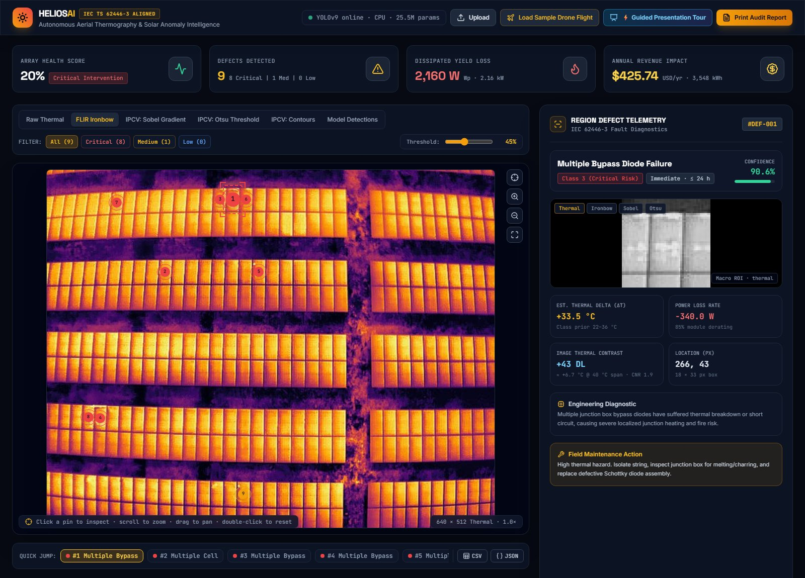

</div>

---

## 📑 Table of Contents

1. [Overview](#-overview)
2. [Feature Highlights](#-feature-highlights)
3. [Quickstart](#-quickstart)
4. [System Architecture](#-system-architecture)
5. [The Inspection Pipeline](#-the-inspection-pipeline)
   - [Stage 0 · Ingestion & normalisation](#stage-0--ingestion--normalisation)
   - [Stage 1 · Classical IPCV](#stage-1--classical-ipcv)
   - [Stage 2 · Deep detection](#stage-2--deep-detection-yolov9)
   - [Stage 3 · Module geometry & homography](#stage-3--module-geometry--homography)
   - [Stage 4 · IEC TS 62446-3 enrichment](#stage-4--iec-ts-62446-3-enrichment)
   - [Stage 5 · Plant KPIs & economics](#stage-5--plant-kpis--economics)
   - [Stage 6 · Evidence packaging](#stage-6--evidence-packaging)
   - [Request lifecycle](#request-lifecycle)
6. [The Interactive Cockpit](#-the-interactive-cockpit)
7. [Evaluation & Benchmarks](#-evaluation--benchmarks)
8. [Installation](#-installation)
9. [Usage](#-usage)
10. [API Reference](#-api-reference)
11. [Configuration](#-configuration)
12. [Project Structure](#-project-structure)
13. [Deployment & Operations](#-deployment--operations)
14. [Troubleshooting](#-troubleshooting)
15. [Assumptions & Limitations](#-assumptions--limitations)
16. [Roadmap](#-roadmap)
17. [Contributing](#-contributing)
18. [License, Citation & Acknowledgements](#-license-citation--acknowledgements)

---

## 🌍 Overview

### The problem

Utility-scale PV plants lose yield, and occasionally burn, because of faults that are invisible in the visible spectrum: failed bypass diodes, cracked or shunted cells, open strings and reversed polarity. **Aerial infrared thermography** finds them quickly, but a single flight produces thousands of frames that someone must interpret, grade for risk, price and turn into work orders.

### What HELIOS-AI does

HELIOS-AI turns one thermal frame into an **auditable, quantified maintenance decision**:

1. **Normalises** any thermal frame (EXIF orientation, 16-bit radiometric TIFF, aspect-true resize).
2. **Explains the image with classical IPCV** — CLAHE + Ironbow, Sobel gradient magnitude, Otsu segmentation, image statistics.
3. **Detects nine PV fault classes** with a pre-trained YOLOv9 thermal model (`ThermalDetector/Th_G_v9.pt`, used as-is — no re-training).
4. **Recovers module geometry** — table contours, sub-pixel corners and a rectifying homography.
5. **Grades every anomaly** to IEC TS 62446-3 Class 1–3, estimates ΔT, **measures** hotspot contrast from pixels and prices the power, energy and revenue loss.
6. **Presents** everything in an interactive cockpit with a hands-free guided tour, and **issues** a two-page printable inspection certificate and work order.

### Design principles

| Principle | How it shows up |
|---|---|
| **Not a model wrapper** | The detector is one of six stages; classical IPCV, geometry and domain physics each produce their own verifiable outputs. |
| **Explainable by construction** | Every layer the model sees can be displayed; every number in the report has a stated formula and assumption. |
| **Honest physics** | Class-conditional ΔT estimates are kept separate from image-measured contrast, and the radiometric assumption is printed on the certificate. |
| **Deterministic & benchmarked** | Identical outputs across runs; latency, FLOPs, memory and perturbation stability are measured by a reproducible script. |
| **Production hygiene** | Input validation, size limits, thread-safe inference, start-up warm-up, no runtime package installs, CPU-only container. |

### At a glance

| Metric | Value |
|---|---|
| Fault classes | 9 (module, substring and string-level faults) |
| Detector | YOLOv9 (GELAN), 25.5 M parameters, 103.7 GFLOPs @ 640² |
| CPU latency | ≈ 0.33 s detection · ≈ 0.42 s full pipeline (12-thread x86 CPU) |
| Geometry accuracy | 0.48 px mean corner error on a synthetic 28° oblique view |
| Sample result | 9 anomalies (8 × Class 3, 1 × Class 2) · 2.16 kW dissipated · ≈ 3,548 kWh/yr |
| Outputs | JSON API · 6 image layers · 4 macro crops per defect · CSV/JSON export · 2-page A4 certificate |

---

## ✨ Feature Highlights

| Area | Capability |
|---|---|
| **Classical IPCV** | CLAHE (clip 2.5, 8×8) + FLIR-style Ironbow · 3×3 Sobel gradient magnitude · Gaussian + Otsu binarisation with an **independent NumPy re-derivation** of t* · histogram, separability η, entropy, RMS contrast, edge density |
| **Geometry** | Otsu segmentation → `findContours` → `approxPolyDP` (ε sweep) → **least-squares edge refinement** → `getPerspectiveTransform` → `warpPerspective` (normalised 640×640 and aspect-true) |
| **Deep detection** | Pre-trained YOLOv9 thermal detector · aspect-true letterboxed inference · **class-agnostic NMS** so a module is never double-counted · candidates down to 20 % confidence for live thresholding |
| **Domain physics** | IEC TS 62446-3 Class 1–3 · class-conditional ΔT prior · **image-measured** hotspot contrast against the Otsu-segmented healthy surface · module- vs. string-level power loss · kWh and revenue impact |
| **Cockpit** | 6 cross-fading layers · severity pins with locked reticle · zoom/pan · 4-modality macro crops · live threshold & severity filters · what-if economics · IPCV lab |
| **Presenter Mode** | Hands-free guided tour through the IPCV layers and every defect with narration, countdown, pause/resume, prev/next, speed and exit |
| **Reporting** | 2-page A4 *Solar Thermographic Inspection Certificate* with scorecard, annotated figure, defect register, SLA, methodology and sign-off blocks · CSV & JSON export |
| **Evaluation** | `evaluate_benchmark.py`: per-stage latency, FPS, params, GFLOPs, memory, determinism, label-free robustness · `ipcv_geometry.py`: ground-truth validated rectification |
| **Engineering** | Input validation (400/413/415/422) · 25 MB upload cap · decompression-bomb guard · thread-safe model lock · start-up warm-up · `YOLO_AUTOINSTALL=false` · CPU Docker image |

---

## 🚀 Quickstart

```powershell
# Windows (PowerShell) — from the repository root
python -m venv venv
.\venv\Scripts\python.exe -m pip install torch torchvision --index-url https://download.pytorch.org/whl/cpu
.\venv\Scripts\python.exe -m pip install -r requirements.txt
.\venv\Scripts\python.exe -m uvicorn api:app --host 127.0.0.1 --port 8000
```

Then open **<http://localhost:8000/?sample=1>** — the bundled flight frame is analysed immediately. Add `&tour=1` to start the guided presentation automatically.

> Linux/macOS, GPU and Docker instructions are in [Installation](#-installation).

---

## 🧱 System Architecture

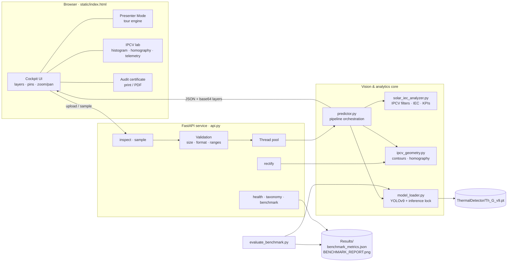

| Component | Responsibility |
|---|---|
| [`api.py`](api.py) | HTTP surface: routing, parameter validation, upload decoding and limits, thread-pool offloading, start-up warm-up, static cockpit. |
| [`predictor.py`](predictor.py) | Orchestrates the six pipeline stages, assigns stable defect IDs, renders crops, encodes layers and records per-stage timings. |
| [`solar_iec_analyzer.py`](solar_iec_analyzer.py) | Fault knowledge base, CLAHE/Sobel/Otsu filters, image statistics, thermal-signature measurement, IEC enrichment, KPI and economics engine, annotation renderer. |
| [`ipcv_geometry.py`](ipcv_geometry.py) | Module-table segmentation, contour → quadrilateral fitting, sub-pixel refinement, homography and rectification; CLI demo with synthetic-oblique validation. |
| [`model_loader.py`](model_loader.py) | Path-independent single model instance and a process-wide inference lock. |
| [`evaluate_benchmark.py`](evaluate_benchmark.py) | Latency, model statistics, memory, determinism and robustness suite; writes the performance card and metrics JSON. |
| [`static/index.html`](static/index.html) | Single-page cockpit: rendering, zoom engine, tour engine, IPCV lab, economics mirror, certificate and exports. |

---

## 🔬 The Inspection Pipeline

Every call to `POST /api/v1/inspect` (or `GET /api/v1/sample`) runs the same deterministic pipeline in `predictor.inspect_thermal_image()`:

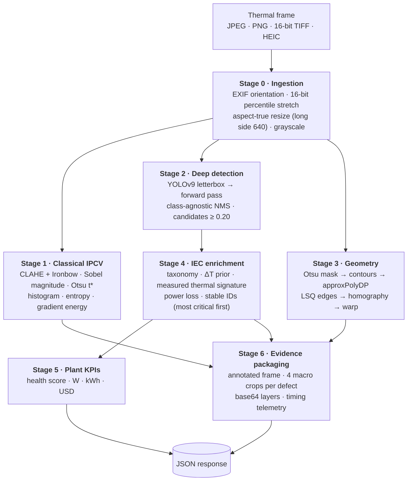

Typical wall-clock on the sample frame (CPU, from `timing_ms`): preprocess ≈ 5 ms · YOLOv9 ≈ 320 ms · IPCV layers & statistics ≈ 20 ms · geometry ≈ 35 ms · enrichment & crops ≈ 8 ms · encoding ≈ 35 ms · **total ≈ 430 ms**.

<p align="center">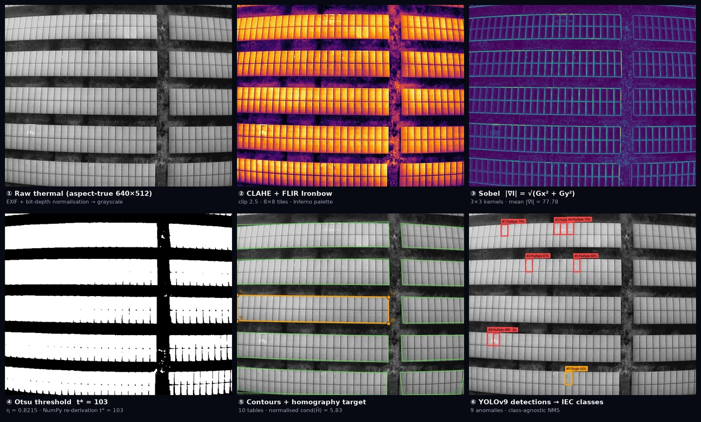</p>
<p align="center"><em>The six layers produced for the sample frame — every one is returned by the API and viewable in the cockpit.</em></p>

### Stage 0 · Ingestion & normalisation

*`predictor._to_rgb8()`, `predictor.preprocess_image()`*

| Step | Detail |
|---|---|
| Orientation | `ImageOps.exif_transpose` applies all eight EXIF orientations. |
| Bit depth | 16/32-bit radiometric frames (`I;16`, `I`, `F`) are stretched to 8 bit with a robust **0.5–99.5 percentile window** instead of being clipped. |
| Aspect-true resize | The long side is scaled to **640 px** (`INTER_AREA` down, `INTER_CUBIC` up). A 640×512 LWIR frame stays 640×512 — YOLO letterboxes internally, so stretching to a square would only distort module geometry and pin positions. |
| Grayscale | Luminance conversion to the single-channel thermal intensity image *I* used by every later stage. |

### Stage 1 · Classical IPCV

*`solar_iec_analyzer.generate_flir_ironbow / generate_sobel_gradient / generate_otsu_threshold / compute_ipcv_statistics`*

**CLAHE + Ironbow.** Contrast-Limited Adaptive Histogram Equalisation (clip limit 2.5, 8×8 tiles) equalises contrast locally without amplifying noise in flat regions; the result is mapped to the Inferno palette — the familiar "Ironbow" view thermographers read.

**Sobel gradient magnitude.** Highlights busbars, cell boundaries and sharp thermal transitions:

```math
G_x = \begin{bmatrix}-1 & 0 & 1\\ -2 & 0 & 2\\ -1 & 0 & 1\end{bmatrix} * I, \qquad
G_y = G_x^{\top} * I, \qquad
\lvert\nabla I\rvert = \sqrt{G_x^{2} + G_y^{2}}
```

The magnitude is min-max normalised and rendered in Viridis.

**Otsu binarisation.** After a 5×5 Gaussian blur, Otsu's method selects the threshold *t\** that maximises the between-class variance of the 256-bin histogram (with *pᵢ* the normalised histogram):

```math
\omega(t)=\sum_{i\le t} p_i,\qquad
\mu(t)=\sum_{i\le t} i\,p_i,\qquad
\sigma_B^{2}(t)=\frac{\big[\mu_T\,\omega(t)-\mu(t)\big]^{2}}{\omega(t)\,\big[1-\omega(t)\big]},\qquad
t^{*}=\arg\max_{t}\,\sigma_B^{2}(t)
```

`otsu_threshold_numpy()` re-derives *t\** from first principles and is cross-checked against `cv2.THRESH_OTSU` on every request (both give **t\* = 103** on the sample). The separability $`\eta = \sigma_B^2(t^*) / \sigma_T^2`$ (0 … 1) quantifies how bimodal the frame is — **η = 0.82** for the sample, i.e. module surface and background are cleanly separable.

**Image statistics** returned in `ipcv`:

| Statistic | Definition | Sample |
|---|---|---|
| `otsu_threshold` / `otsu_threshold_numpy` | OpenCV vs. NumPy *t\** | 103 / 103 |
| `otsu_separability_eta` | σ²_B(t\*) / σ²_T | 0.8215 |
| `hot_pixel_fraction` | share of pixels above *t\** | 63.7 % |
| `entropy_bits` | Shannon entropy $`-\sum p_i \log_2 p_i`$ | 7.53 bits |
| `rms_contrast` | standard deviation of *I* | 60.87 |
| `sobel_mean_magnitude` / `sobel_p95_magnitude` | gradient energy | 77.8 / 324 |
| `edge_density` | share of pixels above the 90th gradient percentile | 10 % |
| `histogram` | 256-bin intensity histogram (drives the cockpit chart) | — |

### Stage 2 · Deep detection (YOLOv9)

*`predictor.run_detector()`, `model_loader.py`*

| Aspect | Detail |
|---|---|
| Model | `ThermalDetector/Th_G_v9.pt` — YOLOv9 (GELAN) `DetectionModel`, 23 blocks, **25.5 M parameters**, used exactly as delivered. |
| Classes | `MultiByPassed`, `MultiDiode`, `MultiHotSpot`, `OpenPV`, `SingleByPassed`, `SingleDiode`, `SingleHotSpot`, `StringOpenCircuit`, `StringReversedPolarity`. |
| Input | Aspect-true 640×512 grayscale frame, letterboxed by Ultralytics to a stride-32 tensor (≈ 83 GFLOPs at this size). |
| Candidate floor | `conf ≥ 0.20` (`DETECTION_FLOOR`) so the cockpit slider can go below the reporting threshold without another inference. |
| Reporting threshold | `conf_threshold` (default **0.45**) decides which detections count towards KPIs, the annotated frame and the certificate (`above_threshold`). |
| NMS | **Class-agnostic**, IoU 0.7. With per-class NMS the model emits overlapping boxes with different labels on the same module (e.g. *SingleDiode* 0.54 and *MultiHotSpot* 0.42 at identical coordinates), which double-counts power loss. |
| Concurrency | A process-wide `threading.Lock` serialises calls into the Ultralytics predictor; FastAPI runs the pipeline in its thread pool so the event loop stays responsive. |
| Warm-up | One dummy inference runs at start-up (FastAPI lifespan), cutting the first real request from ≈ 2.5 s to ≈ 0.45 s. |

### Stage 3 · Module geometry & homography

*`ipcv_geometry.py` — runs inside every inspection and as `POST /api/v1/rectify`*

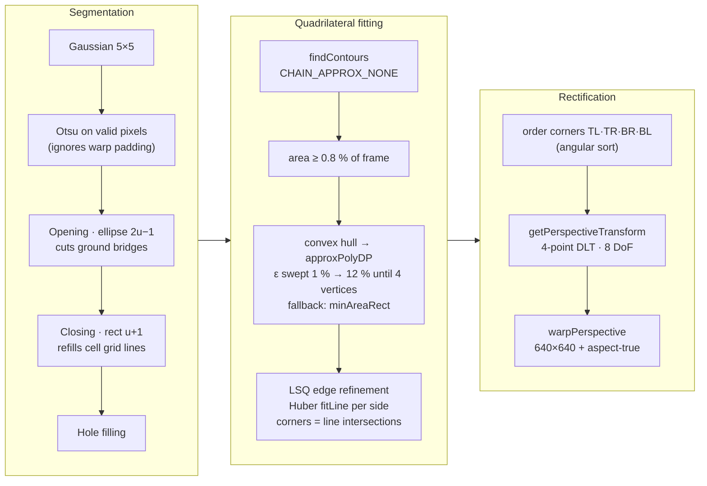

*u* ≈ 4 px at 640-px resolution. Key ideas:

* **Open before close.** Opening first disconnects neighbouring tables joined by warm ground speckle; the small closing afterwards refills the dark inter-cell grid lines so each table becomes one blob.
* **Sub-pixel corners.** `approxPolyDP` can only return pixel-quantised contour points. Every boundary pixel is assigned to its nearest quad side; points in the central 80 % of each side are fitted with a robust (Huber) line, and corners are recomputed as intersections of adjacent lines. This averages hundreds of pixels per edge.
* **Homography.** Four ordered correspondences define $`\mathbf{x}' \sim H\mathbf{x}`$ (8 DoF). Diagnostics report the 4-point re-projection residual and the condition number of the **Hartley-normalised** matrix $`\hat H = T_{dst}\,H\,T_{src}^{-1}`$ (the raw condition number of *H* is dominated by its translation terms and is meaningless).

**Validation.** Because the sample frame is nadir, `python ipcv_geometry.py` synthesises an oblique capture from a physically modelled camera rotation, $`H_{true} = S\,K R K^{-1}`$ (pinhole *K* with *f* = 1.1·width, *R* = pitch 28°, roll 7°), then detects, rectifies and scores against ground truth:

| Metric | Value |
|---|---|
| Module tables detected (nadir / oblique) | 10 / 10 |
| Mean corner re-projection error vs. ground truth | **0.48 px** (2.82 px with `approxPolyDP` alone) |
| NCC(rectified, true top-down) | **0.83** (0.51 without refinement; 0.97 with ground-truth corners, validating the warp itself) |
| Hartley-normalised cond(Ĥ) | 5.2 |
| 4-point re-projection residual | ≈ 4 × 10⁻⁶ px |

<p align="center">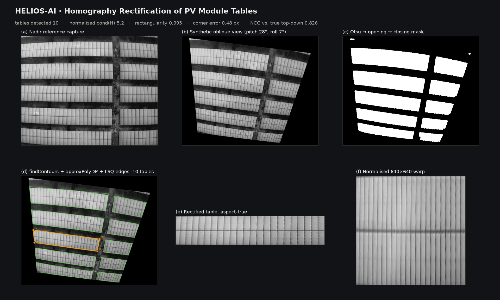</p>

### Stage 4 · IEC TS 62446-3 enrichment

*`solar_iec_analyzer.enrich_detection()`, `measure_thermal_signature()`*

Each detection is mapped through the fault knowledge base:

| Fault class | IEC class | ΔT prior (°C) | Nominal loss | Scope | Field action (abridged) |
|---|---|---|---|---|---|
| `StringReversedPolarity` | **Class 3** · critical emergency | 30–55 | 100 % | **string** | Open the DC disconnect immediately |
| `StringOpenCircuit` | **Class 3** · critical | 10–18 | 100 % | **string** | Check string fuse, DC isolator, inverter input |
| `MultiDiode` | **Class 3** · critical | 22–36 | 85 % | module | Isolate string, replace junction-box diodes |
| `MultiHotSpot` | **Class 3** · critical | 25–45 | 45 % | module | Re-verify and replace module |
| `MultiByPassed` | **Class 2** · medium | 18–28 | 66.6 % | module | Inspect soiling / cell fracture, test diodes |
| `SingleDiode` | **Class 2** · medium | 15–25 | 33.3 % | module | Verify diode leakage, replace on breakdown |
| `SingleHotSpot` | **Class 2** · medium | 14–30 | 20 % | module | I-V curve trace for fill-factor loss |
| `OpenPV` | **Class 2** · medium | 12–20 | 100 % | module | Check MC4 seating and ribbon continuity |
| `SingleByPassed` | **Class 1** · low | 8–15 | 33.3 % | module | Clean, re-scan after 24 h |

**Two independent ΔT figures** are reported and never mixed:

1. **Estimated ΔT (class prior)** — interpolated inside the physical range of the fault class by detection confidence *c*:

   ```math
   \Delta T_{est} = \Delta T_{lo} + (\Delta T_{hi} - \Delta T_{lo})\,(0.8\,c + 0.1)
   ```

2. **Image-measured thermal signature** — computed from pixels around the box:

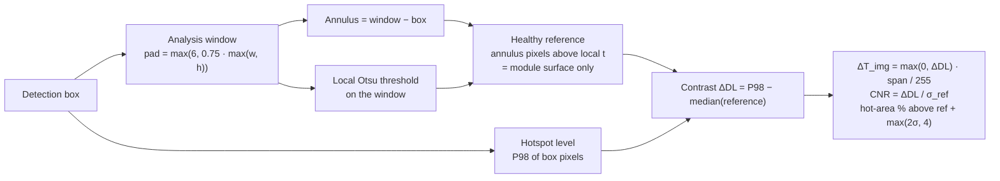

Using only the Otsu-segmented module surface as the reference keeps cold ground, frames and inter-row gaps from inflating the contrast — consistent with IEC TS 62446-3, which defines ΔT against a healthy reference area. `span` is `RADIOMETRIC_SPAN_C` (40 °C by default) and is printed on the certificate.

**Power loss** per detection *i* with nominal loss *Lᵢ* %:

```math
P_i = W_p \cdot \frac{L_i}{100} \cdot n_i, \qquad n_i = \begin{cases}\text{modules per string} & \text{string-level fault}\\ 1 & \text{otherwise}\end{cases}
```

Detections are then sorted **most critical first, then by confidence**, and receive stable IDs `DEF-001 …`, so the pins, inspector, tour and certificate all share one numbering.

### Stage 5 · Plant KPIs & economics

*`solar_iec_analyzer.calculate_site_kpis()` — mirrored client-side by `computeKpis()` for live what-if analysis*

```math
P_{loss} = \sum_i P_i \;[\mathrm{W}],\qquad
E_{year} = \frac{P_{loss}}{1000}\cdot PSH \cdot 365 \;[\mathrm{kWh/yr}],\qquad
C_{year} = E_{year}\cdot \tau \;[\mathrm{USD/yr}]
```

with peak-sun hours *PSH* (default 4.5 h/day) and tariff *τ* (default 0.12 USD/kWh). The **array health score** is a per-frame triage index:

```math
H = \max\!\Big(20,\; 100 - \sum_i \pi(c_i)\Big), \qquad \pi = 15 \text{ (Class 3)},\; 6 \text{ (Class 2)},\; 2 \text{ (Class 1)}
```

| Health score | Status |
|---|---|
| ≥ 90 | Optimal |
| 70 – 89.9 | Attention Required |
| 50 – 69.9 | Action Needed |
| < 50 | Critical Intervention |

Sample frame at 400 Wp, 4.5 PSH, 0.12 USD/kWh: **2,160 W dissipated → 9.72 kWh/day → 3,548 kWh/yr → 425.74 USD/yr**, health 20 % (eight Class 3 anomalies).

### Stage 6 · Evidence packaging

| Output | Detail |
|---|---|
| Layers | `raw`, `ironbow`, `sobel` (JPEG) and `otsu` (lossless PNG) as base64 data URIs |
| Annotated frame | IEC-coloured boxes and `#n Class conf%` labels for detections above threshold |
| Macro crops | Square window around each box (longest side × 1.5, ≥ 48 px, shifted inside the frame) in **four modalities**: thermal, Ironbow, Sobel, Otsu |
| Geometry | Contour overlay, normalised 640×640 and aspect-true rectified tables, homography and diagnostics |
| Telemetry | `timing_ms` (wall-clock per stage) and `yolo_speed_ms` (Ultralytics profiler: preprocess / inference / postprocess) |

### Request lifecycle

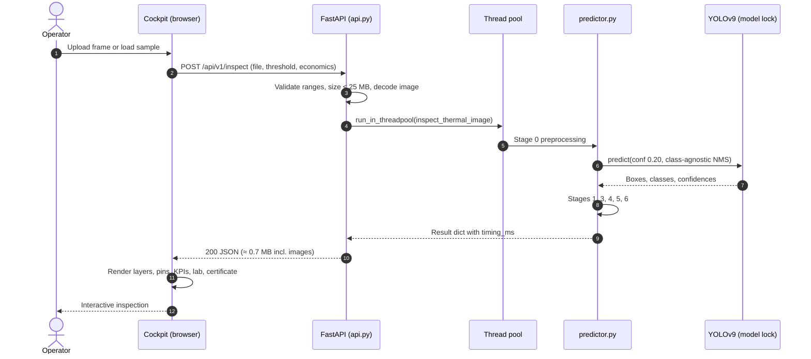

---

## 💻 The Interactive Cockpit

`static/index.html` is a dependency-light single page (Tailwind CSS, Lucide icons, vanilla JavaScript, HTML5 Canvas) served at `/`.

<p align="center">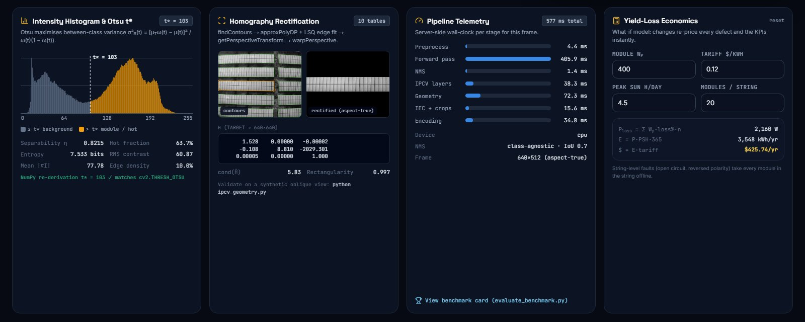</p>

### Client architecture

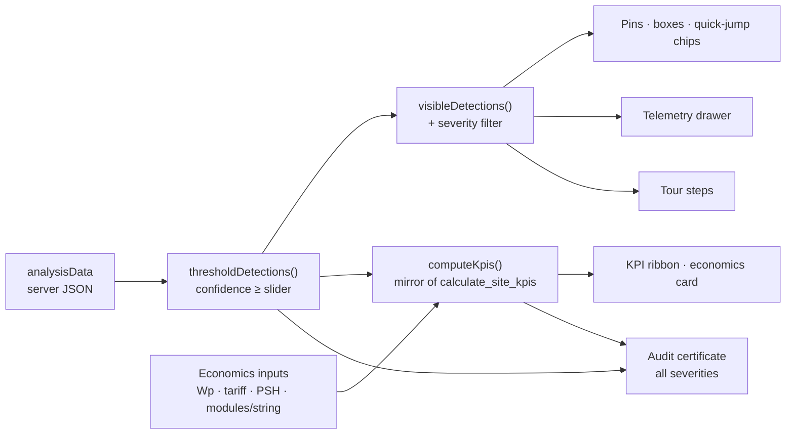

The threshold slider, severity filters and economics inputs never call the server: the response already contains every candidate ≥ 0.20, and the KPI formulas are mirrored in JavaScript, so updates are instant.

### Image layers

| Key | Layer | What it shows |
|---|---|---|
| `1` | **Raw Thermal** | Aspect-true 8-bit frame fed to YOLOv9 |
| `2` | **FLIR Ironbow** | CLAHE + Inferno palette |
| `3` | **IPCV: Sobel Gradient** | \|∇I\| in Viridis — busbars, cell edges, thermal transitions |
| `4` | **IPCV: Otsu Threshold** | Binary module/hot vs. background mask (caption shows *t\**) |
| `5` | **IPCV: Contours** | Module-table quads; amber quad = homography target with TL/TR/BR/BL |
| `6` | **Model Detections** | IEC-coloured boxes, filtered live by threshold and severity |

Layers cross-fade; a caption shows each layer's formula and fades after a few seconds.

### Viewer, pins & telemetry drawer

* **Pins** are keyboard-focusable buttons, colour-coded and pulsing by severity (red Class 3 · amber Class 2 · blue Class 1) and numbered with the stable defect index.
* **Selecting** a pin locks an animated targeting reticle and fills the drawer: IEC badge and SLA, confidence bar, macro crop (Thermal / Ironbow / Sobel / Otsu), estimated ΔT with its class range, power loss (re-priced live), image thermal contrast (ΔDL, ≈ °C, CNR), pixel location and size, engineering diagnostic and field action.
* **Zoom & pan**: scroll zooms at the cursor (1–6×), drag pans, double-click or `Esc` resets, `F` toggles auto-focus on selection. Pins, boxes and the reticle are counter-scaled through a `--zoom` CSS variable so they keep a constant on-screen size.
* **Focus zoom** centres a defect at $`s = \mathrm{clamp}\big(0.3 / \max(w, h),\, 1.8,\, 3.2\big)`$, with translation clamped so the frame never leaves the viewport.

### 🎤 Presenter Mode (guided tour)

Start with **⚡ Guided Presentation Tour**, the `T` key, or `/?sample=1&tour=1`.

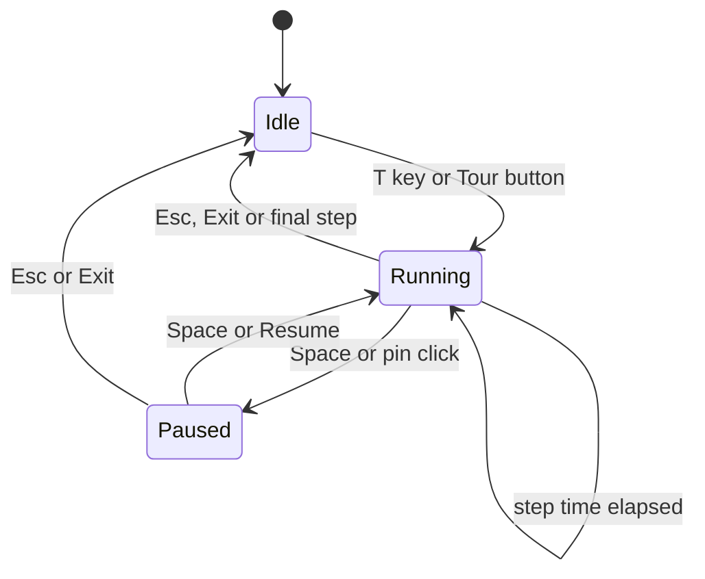

| Phase | Steps | Dwell |
|---|---|---|
| Overview | Raw frame + anomaly count, table count, health | 0.9 × |
| IPCV prelude | Ironbow → Sobel → Otsu (with *t\**, η) → contours/homography → YOLOv9 boxes | 0.75 × each |
| Defects | Every visible defect, most critical first: Ironbow layer, smooth zoom, reticle lock, drawer refresh, narrated IEC class, ΔT, watts and action | 1.0 × each |
| Summary | Critical count, watts dissipated, USD/yr at risk | 1.0 × |

The base dwell is selectable (2.5 / **3.5** / 5 / 7 s); the sample tour lasts ≈ 50 s at the default. The HUD shows step counter, live countdown, progress bar and segment dots with **Prev**, **Pause/Resume**, **Next**, speed and **Exit**. The engine is `requestAnimationFrame`-driven with frame-delta clamping, so a backgrounded tab never skips steps.

### 📄 Audit certificate

**Print Audit Report** opens a native `<dialog>` for plant name, site/block, flight date, inspector, thermographer certification and camera payload (remembered in `localStorage`); **Generate & Print** — or simply `Ctrl+P` — renders a formal **2-page A4 certificate** via print CSS. Example: [`Results/SAMPLE_AUDIT_CERTIFICATE.pdf`](Results/SAMPLE_AUDIT_CERTIFICATE.pdf).

| Page 1 — Inspection Certificate | Page 2 — Defect Register & Work Order |
|---|---|
| Certificate no. `HEL-<date>-<hash>` and issue time | Register: #, Defect Code, Classification (crop thumbnail, confidence, location), Severity Class + SLA, Est. ΔT (+ image ΔT), Power Loss, Action Plan |
| *"Audited in accordance with IEC TS 62446-3:2017 standards"* seal | Methodology & measurement basis for all three layers |
| Plant, site, flight date, inspector, payload, AI engine, source, threshold, economic basis | Economics formulas and stated limitations |
| Executive scorecard: health score, total anomalies, critical count, dissipated peak watts, projected annual revenue loss | **Certified Thermographer Signature** block |
| Annotated figure, severity distribution, primary concern, recommendation | **O&M Operations Manager Stamp** block |

SLA policy: Class 3 → *Immediate, ≤ 24 h* · Class 2 → *Scheduled, ≤ 30 days* · Class 1 → *Monitor, next survey*.

### Exports, shortcuts & deep links

| Shortcut | Action |
|---|---|
| `1` – `6` | Switch layer |
| `←` / `→` | Previous / next defect (or tour step) |
| `T` | Start / stop guided tour |
| `Space` | Pause / resume tour |
| `F` | Toggle focus zoom |
| `Esc` | Exit tour / reset view |

| Deep link | Effect |
|---|---|
| `/?sample=1` | Analyse the bundled frame on open |
| `/?sample=1&layer=sobel` | …and open on a given layer (`raw`, `ironbow`, `sobel`, `otsu`, `contours`, `bbox`) |
| `/?sample=1&tour=1` | …and start the guided tour |

**CSV** exports the defect register; **JSON** exports the full inspection (KPIs, detections, IPCV statistics, geometry, timings, report details) without image payloads.

---

## 📈 Evaluation & Benchmarks

### Methodology

`evaluate_benchmark.py` loads the unchanged weights, runs **3 warm-up + 20 timed iterations** on `Results/INPUT.jpg`, and separates the stages:

* **HELIOS preprocessing** — our own `perf_counter` timing of Stage 0.
* **YOLO letterbox, forward pass, NMS** — the Ultralytics profiler (`result.speed`).
* **IPCV layers** — CLAHE/Ironbow + Sobel + Otsu.
* **End-to-end** — the complete `inspect_thermal_image()` including geometry, crops and encoding (5 iterations).

It also counts parameters, GFLOPs (via `thop`, at 640² and at the actual padded frame), weights size, fp32 parameter memory and process RSS, verifies **determinism** (identical boxes in every iteration), and runs a **label-free robustness** suite. Results go to the console, `Results/benchmark_metrics.json` (served by the API) and `Results/BENCHMARK_REPORT.png`.

### Results (reference run)

Hardware: 12-thread Intel x86-64 CPU, PyTorch 2.15 (CPU, 8 threads), Ultralytics 8.4, 640×512 frame. Expect ±5 % run-to-run variation.

| Stage (20 iterations) | Mean (ms) | p95 (ms) |
|---|---|---|
| HELIOS preprocessing | 3.1 | 3.6 |
| YOLO letterbox / tensor | 1.5 | 2.5 |
| **Neural network forward pass** | **336.4** | 369.6 |
| NMS / postprocessing | 0.8 | 1.3 |
| **Total detection latency** | **341.8** | 376.0 |
| IPCV layers (CLAHE, Sobel, Otsu) | 7.1 | 8.1 |
| Full cockpit pipeline (E2E) | 419.9 | 445.4 |

| Throughput & model | Value |
|---|---|
| Effective FPS (detection path) | 2.93 |
| End-to-end FPS (full pipeline) | 2.38 |
| Parameters | 25,536,171 (25.54 M) |
| GFLOPs @ 640×640 / @ 640×512 frame | 103.72 / 82.97 |
| Weights file / fp32 parameter memory | 51.6 MB / 102.1 MB |
| Process RSS before → after model load / peak | 221 → 357 MB / 712 MB |
| Deterministic across iterations | ✅ Yes |

The forward pass is ≈ 98 % of detection latency, so GPU inference (`--device cuda:0`) or an ONNX/TensorRT export is the lever for real-time use; the classical IPCV stages add only ≈ 7 ms.

### Label-free robustness

Without ground-truth labels, robustness is measured as **prediction consistency**: detections on a perturbed frame are matched one-to-one (IoU ≥ 0.5) to the clean prediction. This measures stability, not accuracy.

| Perturbation | Detections | Recall | Precision | F1 | Class agreement |
|---|---|---|---|---|---|
| Brightness +20 DL | 9 | 1.00 | 1.00 | **1.00** | 1.00 |
| Contrast × 0.8 | 9 | 1.00 | 1.00 | **1.00** | 1.00 |
| Gamma 0.8 | 9 | 1.00 | 1.00 | **1.00** | 1.00 |
| Horizontal flip | 9 | 1.00 | 1.00 | **1.00** | 1.00 |
| JPEG quality 40 | 8 | 0.89 | 1.00 | 0.94 | 1.00 |
| Half-resolution resample | 7 | 0.78 | 1.00 | 0.88 | 0.86 |
| Gaussian blur σ = 1.2 | 4 | 0.44 | 1.00 | 0.61 | 0.75 |
| Gaussian noise σ = 8 DL | 2 | 0.22 | 1.00 | 0.36 | 1.00 |
| **Mean** | | | | **0.85** | |

**Finding:** the detector is invariant to global photometric changes (AGC, gain, gamma) and mirror geometry, but **sensor noise and defocus cause missed detections** (precision stays 1.00 — no false alarms). For low-SNR payloads, a denoising or focus-quality gate before inference is recommended.

<p align="center">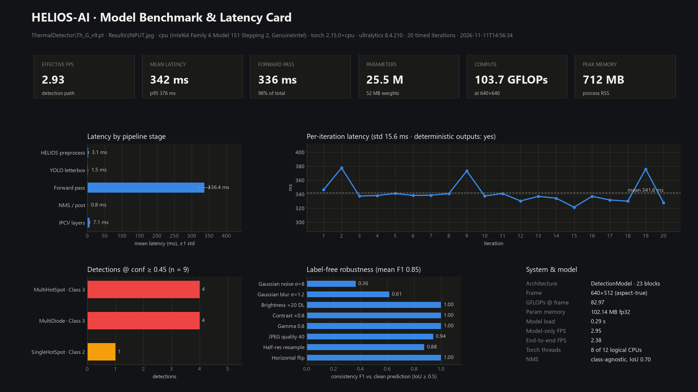</p>

---

## 📦 Installation

### Prerequisites

| Requirement | Notes |
|---|---|
| Python **3.10+** | Developed and tested on 3.12 |
| ~2 GB disk | CPU PyTorch + dependencies (CUDA wheels are much larger) |
| `ThermalDetector/Th_G_v9.pt` | Included in the repository (51.6 MB) |
| Modern browser | Chrome / Edge / Firefox / Safari; internet access for the Tailwind, Lucide and Google Fonts CDNs |
| Optional: NVIDIA GPU | CUDA-enabled PyTorch for GPU inference |
| Optional: Docker | For the containerised CPU service |

### Option A — Windows (PowerShell)

```powershell
git clone <your-fork-url> HELIOS-AI
cd HELIOS-AI
python -m venv venv
.\venv\Scripts\python.exe -m pip install --upgrade pip
.\venv\Scripts\python.exe -m pip install torch torchvision --index-url https://download.pytorch.org/whl/cpu
.\venv\Scripts\python.exe -m pip install -r requirements.txt
```

### Option B — Linux / macOS

```bash
git clone <your-fork-url> HELIOS-AI && cd HELIOS-AI
python3 -m venv venv
source venv/bin/activate
pip install --upgrade pip
pip install torch torchvision --index-url https://download.pytorch.org/whl/cpu   # Linux; on macOS use: pip install torch torchvision
pip install -r requirements.txt
```

### Option C — NVIDIA GPU

Install the CUDA build of PyTorch that matches your driver (see [pytorch.org](https://pytorch.org/get-started/locally/)), e.g.:

```bash
pip install torch torchvision --index-url https://download.pytorch.org/whl/cu124
pip install -r requirements.txt
```

`/api/v1/health` then reports `cuda_active: true`, and the benchmark accepts `--device cuda:0`.

### Option D — Docker (CPU)

```bash
docker compose up --build        # or: docker-compose up --build
```

The image (`python:3.12-slim`) installs CPU-only PyTorch, disables Ultralytics auto-installs, exposes port 8000 and defines a `HEALTHCHECK` against `/api/v1/health`. `.dockerignore` keeps the local `venv/` out of the build context.

### Verify the installation

```bash
python -m uvicorn api:app --host 127.0.0.1 --port 8000
curl http://127.0.0.1:8000/api/v1/health           # → "status": "healthy", "classes_count": 9
python ipcv_geometry.py                             # → corner error ≈ 0.5 px
python evaluate_benchmark.py --no-robustness        # → latency table, writes Results/
```

---

## 🧭 Usage

### Run the service

```bash
python -m uvicorn api:app --host 127.0.0.1 --port 8000           # local
python -m uvicorn api:app --host 0.0.0.0 --port 8000             # LAN / container
```

Interactive OpenAPI docs are available at **`/docs`** (Swagger UI) and **`/redoc`**.

### Five-minute evaluator demo

1. Open `http://localhost:8000/?sample=1` — point out the KPI ribbon (health, defects, watts, USD/yr).
2. Press `2`–`5` to walk through **Ironbow, Sobel, Otsu and Contours**; show the IPCV lab (histogram with *t\** = 103, NumPy ✓, homography matrix).
3. Click the red pin **#1** — show the reticle lock, the four crop modalities, ΔT prior vs. measured contrast, SLA and field action.
4. Drag the **threshold** slider and change **Module Wp** in the economics card — KPIs re-price instantly.
5. Press `T` for the **guided tour** and let it run hands-free; `Space` to pause for questions.
6. **Print Audit Report** → *Generate & Print* → *Save as PDF* to hand over the certificate.
7. Optionally show `python ipcv_geometry.py` and the benchmark card (*View benchmark card* in the telemetry panel).

### Command-line tools

**`evaluate_benchmark.py`**

| Option | Default | Description |
|---|---|---|
| `--image` | `Results/INPUT.jpg` | Benchmark frame |
| `--iterations` | `20` | Timed iterations (≥ 2) |
| `--warmup` | `3` | Untimed warm-up iterations |
| `--e2e-iterations` | `5` | Full-pipeline iterations (0 to skip) |
| `--conf` | `0.45` | Confidence threshold |
| `--imgsz` | `640` | Inference long side |
| `--device` | `auto` | `auto`, `cpu`, `cuda:0` |
| `--output` / `--json` | `Results/BENCHMARK_REPORT.png` / `Results/benchmark_metrics.json` | Output paths |
| `--no-robustness` / `--no-plot` | off | Skip the perturbation suite / the PNG card |

**`ipcv_geometry.py`**

| Option | Default | Description |
|---|---|---|
| `--image` | `Results/INPUT.jpg` | Input frame |
| `--no-simulate` | off | Rectify the input as-is (for genuinely oblique captures) |
| `--pitch` / `--roll` | `28` / `7` | Synthetic camera rotation in degrees |
| `--size` | `640` | Normalised output size |
| `--output` / `--rectified` | `Results/HOMOGRAPHY_RECTIFICATION.png` / `Results/RECTIFIED_PANEL.png` | Output paths |

---

## 📡 API Reference

| Method | Path | Description |
|---|---|---|
| `GET` | `/` | Interactive cockpit |
| `GET` | `/api/v1/health` | Status, device, CUDA, classes, parameters, versions, uptime, benchmark availability |
| `GET` | `/api/v1/taxonomy` | IEC TS 62446-3 fault knowledge base |
| `GET` | `/api/v1/sample` | Full inspection of `Results/INPUT.jpg` |
| `POST` | `/api/v1/inspect` | Full inspection of an uploaded frame |
| `POST` | `/api/v1/rectify` | Module contours + homography rectification |
| `GET` | `/api/v1/benchmark` | Latest `evaluate_benchmark.py` metrics (JSON) |
| `GET` | `/api/v1/benchmark/report` | Latest benchmark performance card (PNG) |
| `POST` | `/predict/` | **Legacy** — annotated JPEG with `X-Anomaly-Count` and `X-Detection-Result` headers |

### Inspection parameters

`/api/v1/inspect` takes multipart form fields; `/api/v1/sample` takes the same names as query parameters.

| Field | Type | Default | Valid range |
|---|---|---|---|
| `file` | image | — (inspect only) | ≤ 25 MB, ≤ 80 MP; anything Pillow decodes (JPEG, PNG, TIFF incl. 16-bit, BMP, WebP, HEIC) |
| `conf_threshold` | float | `0.45` | 0.05 – 0.95 |
| `module_watts` | float | `400` | 10 – 1000 W |
| `tariff_usd` | float | `0.12` | 0 – 5 USD/kWh |
| `sun_hours` | float | `4.5` | 0.5 – 12 h/day |
| `modules_per_string` | int | `20` | 1 – 60 |

### Examples

```bash
# Inspect an upload with custom economics
curl -X POST http://localhost:8000/api/v1/inspect \
  -F "file=@Results/INPUT.jpg" \
  -F "conf_threshold=0.5" -F "module_watts=550" -F "tariff_usd=0.15"

# Bundled sample with a 0.6 threshold
curl "http://localhost:8000/api/v1/sample?conf_threshold=0.6"

# Homography rectification at 512 × 512
curl -X POST http://localhost:8000/api/v1/rectify -F "file=@Results/INPUT.jpg" -F "output_size=512"

# Legacy endpoint: save the annotated JPEG and print the anomaly count header
curl -s -D - -o annotated.jpg -F "file=@Results/INPUT.jpg" http://localhost:8000/predict/ | grep -i x-anomaly
```

```python
# pip install httpx
import base64, httpx

with open("Results/INPUT.jpg", "rb") as fh:
    r = httpx.post("http://localhost:8000/api/v1/inspect",
                   files={"file": ("INPUT.jpg", fh, "image/jpeg")},
                   data={"conf_threshold": "0.45"}, timeout=60)
r.raise_for_status()
report = r.json()

print(report["kpis"]["total_defects"], report["kpis"]["annual_financial_loss_usd"])
for d in report["detections"]:
    if d["above_threshold"]:
        print(d["id"], d["class_name"], d["iec_class"], d["confidence"], d["delta_t_celsius"])

# Layers are data URIs: strip the prefix to get the bytes
png = base64.b64decode(report["otsu_image_base64"].split(",", 1)[1])
open("otsu.png", "wb").write(png)
```

### Response schema (abridged, real output for the sample)

```jsonc
{
  "status": "success",
  "image_dimensions":    { "width": 640, "height": 512 },
  "original_dimensions": { "width": 640, "height": 512 },
  "raw_image_base64": "data:image/jpeg;base64,…",       // also: annotated_, ironbow_, sobel_ (JPEG), otsu_ (PNG)
  "kpis": {
    "total_defects": 9, "critical_count": 8, "medium_count": 1, "minor_count": 0,
    "health_score": 20.0, "health_status": "Critical Intervention",
    "total_watt_loss": 2160.0, "total_kw_loss": 2.16, "daily_kwh_loss": 9.72,
    "annual_kwh_loss": 3547.8, "annual_financial_loss_usd": 425.74,
    "primary_concern": "Multiple Bypass Diode Failure",
    "fault_breakdown": { "Multiple Bypass Diode Failure": 4, "Multiple Cell Hotspots": 4, "Single Cell Hotspot": 1 },
    "assumptions": { "module_watts": 400.0, "tariff_usd_per_kwh": 0.12, "peak_sun_hours": 4.5 }
  },
  "detections": [{
    "id": "DEF-001", "index": 1, "class_id": 1, "code": "MULTI_DIODE",
    "class_name": "Multiple Bypass Diode Failure",
    "confidence": 90.6, "confidence_raw": 0.9055, "above_threshold": true,
    "iec_class": "Class 3", "iec_label": "Class 3 (Critical Risk)", "severity_rank": 0,
    "pin_position": { "x_pct": 41.56, "y_pct": 8.29, "width_pct": 2.81, "height_pct": 6.55 },
    "bbox_pixels": { "x1": 257, "y1": 26, "x2": 275, "y2": 59 },
    "bbox_normalized": [0.40151, 0.05014, 0.4296, 0.11563],
    "delta_t_celsius": 33.5, "delta_t_range": [22.0, 36.0],
    "power_loss_watts": 340.0, "power_loss_pct": 85.0, "loss_scope": "module", "affected_modules": 1,
    "thermal_signature": {
      "roi_peak_dl": 229.0, "reference_dl": 186.0, "contrast_dl": 43.0, "contrast_to_noise": 1.9,
      "hot_area_pct": 0.2, "delta_t_image_celsius": 6.7, "assumed_span_celsius": 40.0, "local_otsu_threshold": 115
    },
    "description": "Multiple junction box bypass diodes have suffered thermal breakdown …",
    "field_action": "High thermal hazard. Isolate string, inspect junction box …",
    "crop_base64": "data:image/jpeg;base64,…"           // also: ironbow_, sobel_, otsu_crop_base64
  }],
  "ipcv": {
    "histogram": [0, 0, 0, 1, "… 256 bins"],
    "otsu_threshold": 103, "otsu_threshold_numpy": 103, "otsu_separability_eta": 0.8215,
    "hot_pixel_fraction": 0.6371, "entropy_bits": 7.533, "rms_contrast": 60.87,
    "sobel_mean_magnitude": 77.78, "sobel_p95_magnitude": 324.0, "edge_density": 0.1,
    "clahe": { "clip_limit": 2.5, "tile_grid": [8, 8] }
  },
  "geometry": {
    "modules_detected": 10,
    "quads": [{ "corners_px": [[0.0, 230.3], [427.0, 235.6], [427.0, 309.7], [0.0, 302.9]],
                "rectangularity": 0.997, "aspect_ratio": 5.826, "method": "approxPolyDP + LSQ edge refinement" }],
    "homography": [[1.528464, 0.0, -1.8e-05], [-0.108308, 8.810352, -2029.300856], [5e-05, 0.0, 1.0]],
    "diagnostics": { "normalized_condition_number": 5.83, "reprojection_residual_px": 0.0 },
    "overlay_base64": "…", "rectified_base64": "…", "rectified_aspect_base64": "…"
  },
  "analysis": { "conf_threshold": 0.45, "detection_floor": 0.2, "agnostic_nms": true, "nms_iou": 0.7,
                "modules_per_string": 20, "radiometric_span_celsius": 40.0 },
  "timing_ms": { "preprocess": 4.5, "inference_wall": 324.3, "ipcv_layers": 21.7, "geometry": 35.8,
                 "postprocess": 8.2, "encoding": 37.2, "total": 431.8 },
  "yolo_speed_ms": { "preprocess": 0.84, "inference": 320.79, "postprocess": 0.71 },
  "model_info": { "name": "YOLOv9-Thermal", "weights": "ThermalDetector/Th_G_v9.pt", "device": "cpu",
                  "standard": "IEC TS 62446-3 Aligned", "classes": { "0": "MultiByPassed", "…": "…" } },
  "source": { "name": "INPUT.jpg", "kind": "sample" }
}
```

### Errors

| Status | When |
|---|---|
| `400` | Empty upload |
| `404` | Sample image or benchmark artefacts missing |
| `413` | Upload > 25 MB, or image > 80 megapixels |
| `415` | Unrecognised or corrupt image |
| `422` | Parameter out of range (message lists every violation) |
| `500` | Unexpected pipeline failure (message included) |

---

## 🔧 Configuration

| Setting | Where | Default | Meaning |
|---|---|---|---|
| `HELIOS_WEIGHTS` | environment | `ThermalDetector/Th_G_v9.pt` | Alternative checkpoint path |
| `YOLO_AUTOINSTALL` | environment | `false` (set by `model_loader.py`) | Prevents Ultralytics from pip-installing packages at runtime |
| `ANALYSIS_LONG_SIDE` | `predictor.py` | `640` | Inference / analysis long side (aspect preserved) |
| `DETECTION_FLOOR` | `predictor.py` | `0.20` | Lowest confidence returned to the cockpit |
| `NMS_IOU` | `predictor.py` | `0.7` | IoU for class-agnostic NMS |
| `CROP_PADDING` | `predictor.py` | `0.25` | Context margin of macro crops |
| `DEFAULT_MODULE_WATTS` | `solar_iec_analyzer.py` | `400` | Module peak power (Wp) |
| `DEFAULT_PEAK_SUN_HOURS` | `solar_iec_analyzer.py` | `4.5` | Equivalent peak-sun hours per day |
| `DEFAULT_TARIFF_USD_PER_KWH` | `solar_iec_analyzer.py` | `0.12` | Energy value |
| `DEFAULT_MODULES_PER_STRING` | `solar_iec_analyzer.py` | `20` | String length for string-level faults |
| `RADIOMETRIC_SPAN_C` | `solar_iec_analyzer.py` | `40.0` | Assumed linear °C span of an 8-bit frame |
| `SEVERITY_PENALTY` | `solar_iec_analyzer.py` | `15 / 6 / 2` | Health-score penalty per Class 3 / 2 / 1 |
| `CLAHE_CLIP_LIMIT`, `CLAHE_TILE_GRID` | `solar_iec_analyzer.py` | `2.5`, `(8, 8)` | CLAHE parameters |
| `MAX_UPLOAD_BYTES` | `api.py` | 25 MB | Upload size cap |
| `Image.MAX_IMAGE_PIXELS` | `api.py` | 80,000,000 | Decompression-bomb guard |

The cockpit persists the economics inputs (`helios.econ`) and certificate details (`helios.report`) in the browser's `localStorage`.

---

## 📂 Project Structure

```
HELIOS-AI-SolarPanel-Defect-Dectector/
├── api.py                         # FastAPI service: routes, validation, warm-up, thread-pool inference
├── predictor.py                   # Pipeline orchestration (stages 0-6), crops, encoding, telemetry
├── solar_iec_analyzer.py          # IPCV filters & statistics, thermal signature, IEC taxonomy, KPIs
├── ipcv_geometry.py               # Contours, sub-pixel corners, homography, rectification + CLI demo
├── evaluate_benchmark.py          # Latency / model statistics / robustness suite + performance card
├── model_loader.py                # Path-safe YOLOv9 instance + inference lock
├── static/
│   └── index.html                 # Cockpit: layers, zoom, tour, IPCV lab, economics, certificate
├── ThermalDetector/
│   └── Th_G_v9.pt                 # Pre-trained YOLOv9 thermal defect model (unchanged)
├── Results/
│   ├── INPUT.jpg                  # Bundled 640×512 aerial LWIR sample frame
│   ├── OUTPUT.png                 # Original reference detection output
│   ├── BENCHMARK_REPORT.png       # Performance card            ← evaluate_benchmark.py
│   ├── benchmark_metrics.json     # Machine-readable metrics    ← evaluate_benchmark.py
│   ├── HOMOGRAPHY_RECTIFICATION.png  # 6-panel geometry figure  ← ipcv_geometry.py
│   ├── RECTIFIED_PANEL.png        # Normalised 640×640 warp     ← ipcv_geometry.py
│   └── SAMPLE_AUDIT_CERTIFICATE.pdf  # Example printed certificate
├── docs/images/                   # README screenshots and figures
├── requirements.txt · Pipfile     # Dependencies
├── Dockerfile · docker-compose.yml · .dockerignore
├── FINAL_TOUCHUPS_AND_OPUS_PROMPT.md  # Project brief for the final polish
└── LICENSE
```

---

## 🚢 Deployment & Operations

* **Concurrency.** Inference is serialised per process by `model_lock`; scale out with multiple Uvicorn workers or replicas (`--workers N`). Each worker loads its own model (≈ 360 MB RSS after load, ≈ 700 MB peak on CPU).
* **Start-up.** Allow a few seconds for the lifespan warm-up before routing traffic; the Docker `HEALTHCHECK` has a 60 s start period.
* **Payload size.** A full inspection response is ≈ 0.7 MB (all layers and crops inline). Clients that only need numbers can ignore the `*_base64` fields; the legacy `/predict/` endpoint returns just the annotated JPEG.
* **Security.** Uploads are size-capped, decoded defensively and never written to disk. CORS is open (`*`, no credentials) for easy integration; restrict `allow_origins` in `api.py` for internet-facing deployments and place the service behind an authenticating reverse proxy.
* **Reproducibility.** Inference is deterministic on a given machine; re-run `evaluate_benchmark.py` after changing hardware, PyTorch or Ultralytics versions and commit the refreshed `Results/` artefacts.

---

## 🧰 Troubleshooting

| Symptom | Cause & fix |
|---|---|
| `pip install` downloads several GB | Default PyTorch wheels include CUDA. Install CPU wheels first: `pip install torch torchvision --index-url https://download.pytorch.org/whl/cpu`. |
| `FileNotFoundError: YOLOv9 thermal weights not found` | `ThermalDetector/Th_G_v9.pt` is missing (check Git LFS / download) or `HELIOS_WEIGHTS` points elsewhere. |
| Cockpit is unstyled or icons are missing | The Tailwind, Lucide and Google Fonts CDNs are blocked; the page needs internet access (see [Roadmap](#-roadmap)). |
| `Address already in use` | Another process uses port 8000 — start with `--port 8001`. |
| First request is slow | Wait for `Application startup complete`; the warm-up inference runs before that line. |
| Upload returns `415` | The file is not an image Pillow can decode (or is truncated). HEIC requires `pi-heif` (in `requirements.txt`). |
| *View benchmark card* says no benchmark | Run `python evaluate_benchmark.py` once; it writes `Results/benchmark_metrics.json`. |
| Printout shows the dashboard or misses colours | Print from Chrome/Edge/Firefox via the button or `Ctrl+P`, paper size A4, scale 100 %; colours are forced with `print-color-adjust: exact`. |
| Box-drawing characters garbled in the console | The CLIs switch stdout to UTF-8; use Windows Terminal or a UTF-8 capable terminal. |

---

## 📌 Assumptions & Limitations

* **Temperatures are relative.** 8-bit JPEG exports are AGC-scaled. *Est. ΔT* is a class-conditional prior; *image ΔT* assumes a linear 40 °C span. Use radiometric data (R-JPEG / 16-bit TIFF with calibration) and on-site verification for compliance-grade temperatures.
* **Single-frame analysis.** Each frame is graded independently; overlapping frames of the same array are not yet de-duplicated or geo-referenced.
* **Health score** is a per-frame triage index, not a plant-capacity metric.
* **Standards alignment.** Severity grading and reporting follow the structure of IEC TS 62446-3; HELIOS-AI is not an accredited certification body, and the SLA policy is an O&M convention rather than part of the standard.
* **Model scope.** Detection quality is bounded by the pre-trained weights; the robustness suite shows sensitivity to sensor noise and blur.
* **Geometry.** Rectification targets planar module tables; strong lens distortion should be corrected (camera calibration) before metric measurements.
* **Front-end assets** load from public CDNs.

---

## 🔭 Roadmap

- [ ] Bundle Tailwind, Lucide and fonts locally for fully offline demos
- [ ] Radiometric R-JPEG decoding (DJI Thermal SDK) for absolute temperatures and true ΔT
- [ ] GPS/EXIF geo-tagging and orthomosaic integration; de-duplication across overlapping frames
- [ ] Lens-distortion calibration before rectification
- [ ] ONNX / TensorRT export and batched flight processing
- [ ] Optional denoising / focus-quality gate informed by the robustness results
- [ ] Unit tests and CI (pipeline, API contract, geometry regression)

---

## 🤝 Contributing

1. Fork and create a feature branch.
2. Keep changes modular — IPCV in `solar_iec_analyzer.py` / `ipcv_geometry.py`, orchestration in `predictor.py`, HTTP in `api.py`.
3. Before opening a PR, run:
   ```bash
   python -m py_compile api.py predictor.py solar_iec_analyzer.py ipcv_geometry.py evaluate_benchmark.py model_loader.py
   python ipcv_geometry.py
   python evaluate_benchmark.py
   ```
   and check the cockpit at `/?sample=1` (layers, tour, print preview).
4. Describe behavioural changes and attach refreshed `Results/` artefacts when metrics change.

---

## 📜 License, Citation & Acknowledgements

Released under the [MIT License](LICENSE).

```bibtex
@software{helios_ai_2026,
  title  = {HELIOS-AI: Autonomous Aerial Thermography and PV Anomaly Intelligence},
  year   = {2026},
  note   = {YOLOv9 thermal detection with classical IPCV, homography rectification and IEC TS 62446-3 grading},
  url    = {https://github.com/<owner>/HELIOS-AI-SolarPanel-Defect-Dectector}
}
```

* **Standard:** IEC TS 62446-3:2017 — *Photovoltaic systems — Requirements for testing, documentation and maintenance — Part 3: Photovoltaic modules and plants — Outdoor infrared thermography.*
* **Dataset:** the detector was trained on aerial PV thermography ([Kaggle: Solar Panel Images](https://www.kaggle.com/pkdarabi/solarpanel)).
* **Built with:** [Ultralytics](https://github.com/ultralytics/ultralytics), [PyTorch](https://pytorch.org/), [OpenCV](https://opencv.org/), [FastAPI](https://fastapi.tiangolo.com/), [Matplotlib](https://matplotlib.org/), [Tailwind CSS](https://tailwindcss.com/) and [Lucide](https://lucide.dev/).
